# World population cartogram, updated

*[Versão em português](README.pt.md)*

Every square is **500,000 people**. Countries keep their rough shape and their place on the
world map, so India and China fill half of Asia, Nigeria dominates Africa, and Canada, Russia
and Australia almost disappear. 16,432 squares show where the world's 8.2 billion people live.

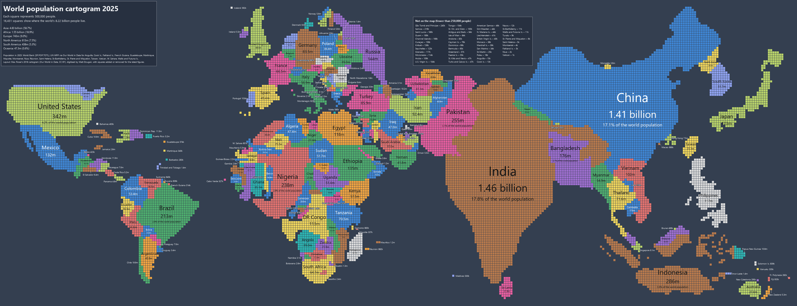

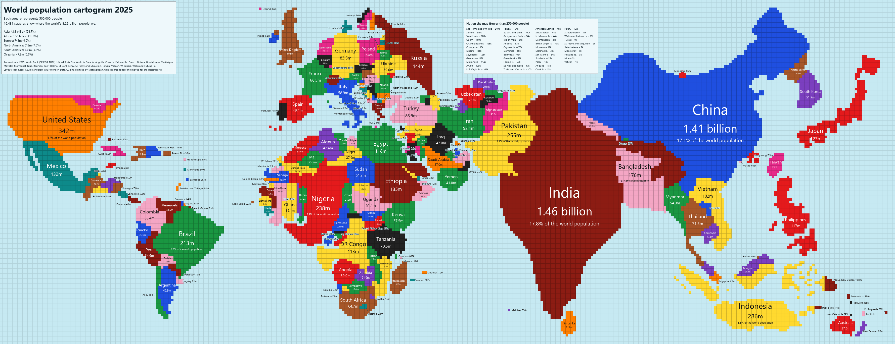

This project updates **Max Roser's 2018 cartogram** for Our World in Data to the latest
population figures (2025 for every country listed by the World Bank). It starts from the 2018
layout, square by square, and only adds or removes the squares each country gained or lost.
The arrangement of the continents stays as in the original.

## Credits and sources

This map would not exist without:

- **Max Roser – Our World in Data (2018)**: [*The map we need if we want to think about how global
  living conditions are changing*](https://ourworldindata.org/world-population-cartogram), the
  cartogram this layout is based on. CC BY 4.0.
- **Matt Dzugan – [World-Population-Cartogram](https://github.com/mattdzugan/World-Population-Cartogram)**:
  the 2018 cartogram digitised by hand into data (one row per square). The repository's FAQ asks how
  to make the map for another year; this project is one answer.
- **TeaDranks – World Population Cartogram 2015**, posted on Reddit's r/MapPorn in January 2015
  ([NPR article](https://www.npr.org/sections/goatsandsoda/2015/01/28/381971608/india-grows-russia-shrinks-mapping-countries-by-population)),
  the inspiration for the light theme.
- **Population data**: [World Bank, SP.POP.TOTL](https://data.worldbank.org/indicator/SP.POP.TOTL)
  (CC BY 4.0), latest year per country; for the territories it does not list (Taiwan, Western
  Sahara, the French overseas departments...), [UN World Population Prospects via Our World in
  Data](https://ourworldindata.org/grapher/population) (CC BY 4.0).
- **Map data**: [Natural Earth](https://www.naturalearthdata.com/) (public domain), for country
  names and for the computed layout.
- **Method of the computed layout**: M. T. Gastner and M. E. J. Newman, *Diffusion-based method for
  producing density-equalizing maps*, PNAS 101 (2004).
- **Outline style**: inspired by [Worldmapper](https://worldmapper.org/maps/population-year-2022/)
  (Benjamin Hennig, Danny Dorling and colleagues); the areas are corrected with J. A. Dougenik,
  N. R. Chrisman and D. R. Niemeyer, *An algorithm to construct continuous area cartograms*,
  The Professional Geographer 37 (1985).
- **Colour-blind palette**: Okabe & Ito and Paul Tol.
- **Map style**: Equal Earth (Šavrič, Patterson & Jenny, 2018), Robinson (1963), Winkel Tripel
  (1921), Mollweide (1805), Mercator, Miller (1942), Gall–Peters (Gall 1855, Peters 1973) and
  equirectangular projections. Natural breaks: G. F. Jenks (1967), computed exactly with
  W. D. Fisher's method (1958). Colour ramps: Viridis, Magma and Cividis
  (matplotlib), Turbo (Google, used for `rainbow`) and ColorBrewer (Cynthia Brewer).

## Usage

Requires Python 3.9+ and:

```bash
pip install numpy scipy pillow
pip install reportlab          # optional: vector PDF output
```

```bash
python population_cartogram.py --theme both --lang en -o map.png      # map_light.png + map_dark.png
python population_cartogram.py --theme dark --palette pastel --lang pt
python population_cartogram.py --style outlines --theme dark          # smooth outlines, Worldmapper style
python population_cartogram.py --style map --projection robinson       # ordinary map, coloured by population
python population_cartogram.py --year 2050 --theme dark                # UN projection
python population_cartogram.py --region europe --theme dark            # one continent, bigger squares
python population_cartogram.py --color-by gdp                          # thematic map
python population_cartogram.py -o map.svg                              # vector output
python population_cartogram.py --csv figures.csv                       # also export the numbers used
python population_cartogram.py --list-palettes
```

The first run downloads the data (a few MB) to `~/.cache/population_cartogram`. Population
figures are refreshed after 30 days, so running it again next year gives next year's map.

### Outlines instead of squares

`--style outlines` draws a continuous cartogram, like the ones by Worldmapper: the real country
borders, stretched and squeezed so that every country's area is proportional to its population.
Countries stay joined to their neighbours.

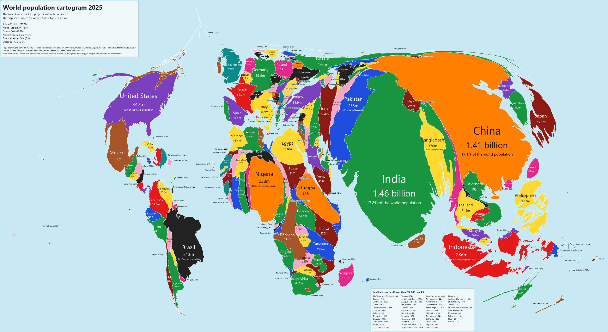

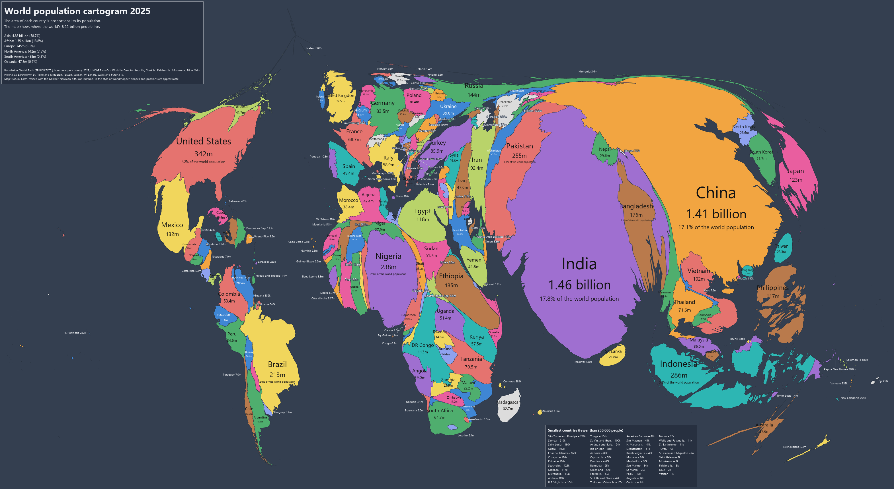

All the other options work the same way: `--year`, `--region`, `--color-by`, `--theme`,
`--palette`, `--lang` and SVG output.

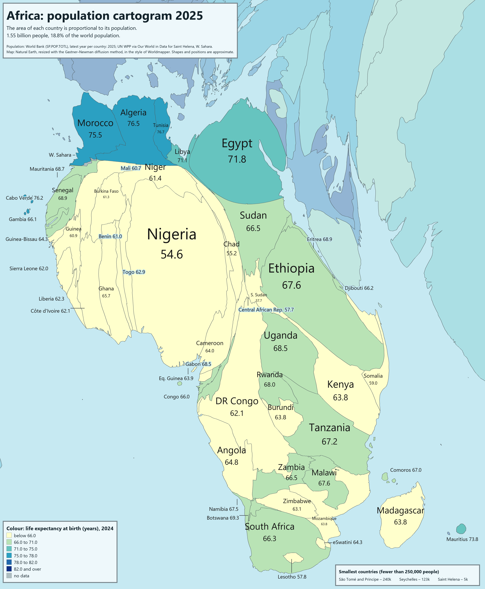

The first run of a year takes a few minutes; the result is cached.

### An ordinary map instead of a cartogram

Cartograms of far-off years get very distorted: by 2050, and even more by 2100, Africa and South
Asia swell and the continents lose their shape. `--style map` draws the usual geographic map
instead, with the countries coloured by population on a scale from the smallest country to the
largest:

```bash
python population_cartogram.py --style map                                      # Equal Earth, 7 classes
python population_cartogram.py --style map --projection robinson --year 2100 --ramp rainbow --classes 9
python population_cartogram.py --style map --region europe --color-by life --ramp viridis
```

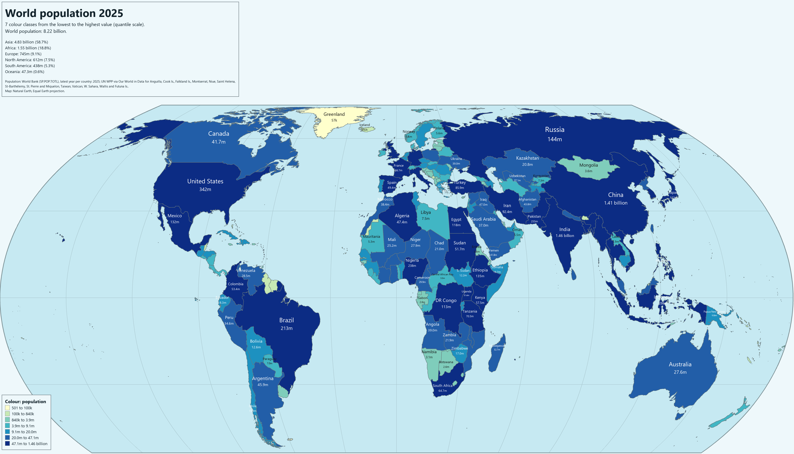

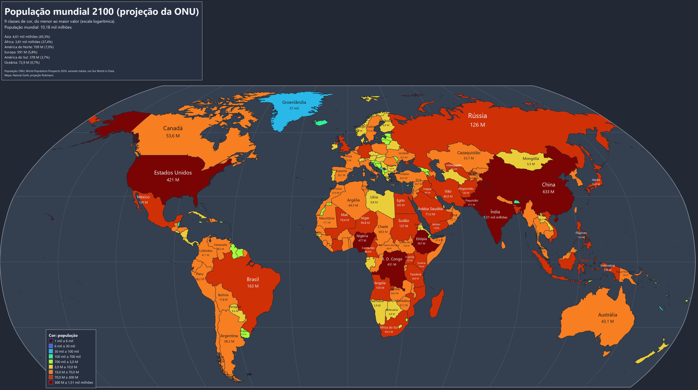

- **Projections** (`--projection`): `equal-earth` (default; equal-area, so large countries are
  not exaggerated), `robinson`, `winkel-tripel` (National Geographic's world maps), `mollweide`
  (equal-area), `mercator` and `web-mercator` (online maps; they greatly enlarge Greenland,
  Canada and Russia), `miller` (Mercator toned down so the poles fit), `gall-peters`
  (equal-area, stretched north–south in the tropics) and `equirectangular` (plate carrée:
  longitude and latitude as a plain grid). `--central-meridian 150` centres the map on the Pacific.
- **Classes** (`--classes N`, 2 to 12, default 7): the scale runs from the lowest to the highest
  value of the countries shown. `--breaks quantile` (default) ranks the countries and gives every
  class the same number of them — with 233 countries and 9 classes, 26 in each — so no class is
  left empty; each limit is the roundest number between the last country of one class and the
  first of the next. `jenks` (natural breaks) puts the limits in the widest gaps between values,
  keeping similar countries together (on a logarithmic scale for positive values). `log` and
  `linear` make equal steps; with values as uneven as population, most countries fall in a few
  classes and some classes may stay empty (the log says how many).
- **Colours** (`--ramp`): `palette` (the palette's own ramp, default), gradients `blues`,
  `greens`, `reds`, `ylorrd`, `ylgnbu`, the perceptually uniform `viridis`, `magma` and `cividis`
  (also readable by colour-blind people), and the rainbow scales `rainbow` (Turbo) and
  `spectral`. Add `_r` to reverse one, e.g. `viridis_r`.
- `--region`, `--year`, `--color-by`, `--theme`, `--lang` and SVG work as with the cartograms.

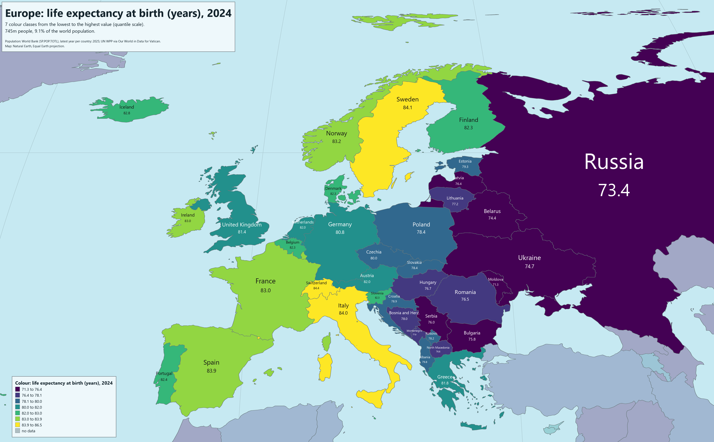

`--classes`, `--breaks` and `--ramp` also work on the cartograms with `--color-by`.

#### Which projection and classes to choose?

No flat map of the globe keeps both areas and shapes; each projection gives up something.

| Projection | Keeps | Gives up | Good for |
|---|---|---|---|
| `equal-earth` | areas | some shape near the poles | **thematic world maps** (the best choice) |
| `mollweide` | areas | shapes squashed towards the edges | thematic maps, as an alternative |
| `robinson`, `winkel-tripel` | neither exactly, a balance of both | small errors everywhere | general world maps that look natural |
| `mercator`, `web-mercator` | local shapes and angles | areas: Greenland looks as big as Africa | matching online maps; navigation |
| `miller` | almost the shapes | areas, though less than Mercator | when Mercator's poles are too much |
| `gall-peters` | areas | shapes: tropics stretched up, high latitudes flattened | showing what an equal-area rectangle looks like |
| `equirectangular` | north–south distances | width, more and more with latitude | data on a latitude/longitude grid |

On a map coloured by country the eye judges by the painted area, so an equal-area projection
(`equal-earth`, `mollweide`) gives the fairest picture. For the classes, `quantile` (default)
uses every colour evenly and is the safest; `jenks` is better when the values form clear groups.
`log` and `linear` suit values that are already evenly spread, such as percentages.

### Past and future years

`--year` draws any year from 1950 to 2100. Years up to the latest World Bank figures use the
World Bank's estimates; later years use the **UN World Population Prospects 2024 projection**
(medium variant). In 2050 the world needs 19,322 squares, and a quarter of them are African:

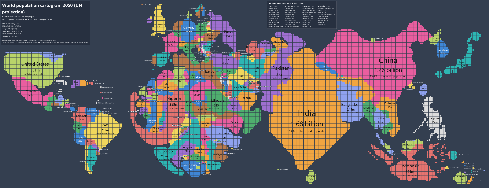

### Regions

`--region europe` (or `africa`, `asia`, `north-america`, `south-america`, `americas`, `oceania`)
cuts the map around one continent, with bigger squares and labels. Neighbouring countries stay
in view, faded.

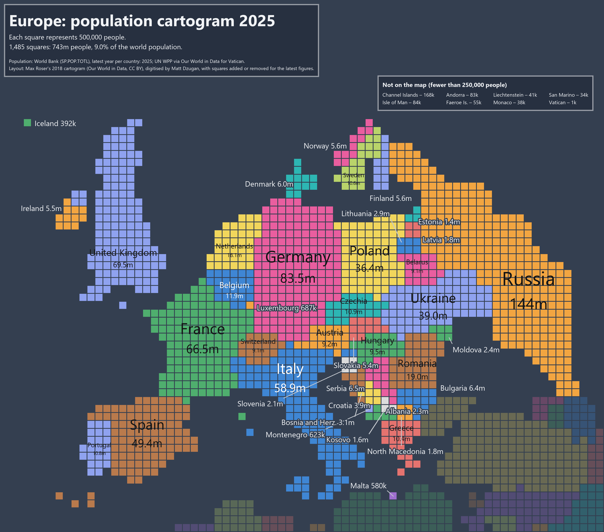

### Thematic maps

`--color-by` colours the countries by a value instead of telling them apart, so each square
counts the same number of people *and* shows what their country is like:

| Value | Colours by |
|---|---|
| `continent` | continent |
| `growth` / `growth:2000` | population change since a base year (default: 10 years earlier, or today for a projection) |
| `gdp`, `life`, `fertility`, `urban`, `density` | GDP per capita, life expectancy, fertility rate, urban share, population density (World Bank) |
| `wb:CODE` | any World Bank indicator, e.g. `wb:SE.ADT.LITR.ZS` (literacy) |
| `csv:FILE` | your own values, `iso3,value` (the header's second column names them) |

Values are split into classes of about the same number of countries; the legend and every
label show them, and borders separate countries that share a colour.

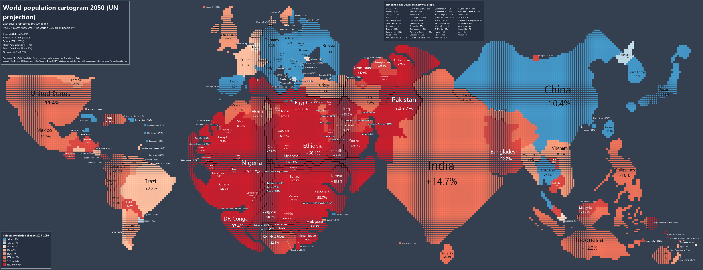

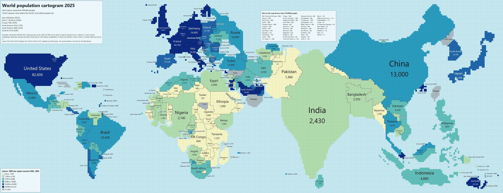

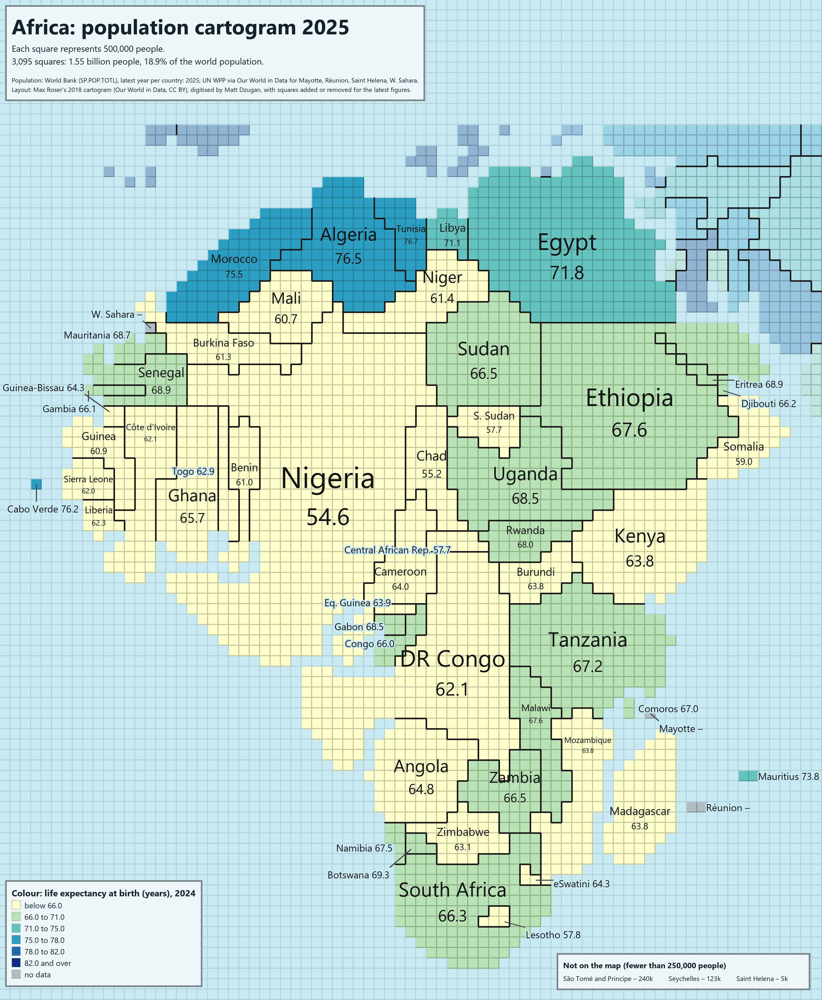

### SVG

With `-o map.svg` the map is written as vector graphics: it stays sharp at any zoom and can be
edited. Every country is a group with its ISO code as `id` and its name and population as a
tooltip, so the file can be restyled or reused on a web page. See
[world_2025_classic_dark.svg](examples/world_2025_classic_dark.svg).

On `--style map` an SVG is labelled for zooming in: every name is fitted whole inside its
country, as big as it fits, down to 1.5 px — Luxembourg or Montenegro look like small grey marks
at 100% and read clearly at 400–800%. Only countries too small to hold any text (Vatican, Monaco,
Caribbean islands) get a small label beside them. On the world map every country is named. See
[world_2025_map.svg](examples/world_2025_map.svg).

### PDF

With `-o map.pdf` the same drawing is written as a vector PDF, ready to print or to place in a
document: labels as real text in the embedded font (searchable and selectable), and on
`--style map` the same zoomable labels as the SVG. A PDF is always drawn in the light theme,
since it is meant for paper; `--theme dark` or `both` are ignored. It needs `reportlab`; without
it the PDF holds a picture of the PNG. One pixel of the map is 0.75 pt, so a world map comes out
as a large page — print it with "fit to page".

### Options

| Option | What it does |
|---|---|
| `--theme light\|dark\|both` | Light theme (2015 style), dark theme (2018 style) or both |
| `--palette NAME` | Colour palette from `palettes.json` (default: `classic`) |
| `--palettes FILE` | Use another palette file |
| `--list-palettes` | List the palettes, check them for colours that look alike, and exit |
| `--style squares\|outlines\|map` | `squares` (default): one square per 500,000 people. `outlines`: smooth country outlines with areas proportional to population. `map`: ordinary geographic map coloured by population |
| `--layout 2018\|auto` | Squares only. `2018` (default): the 2018 layout updated to the latest figures. `auto`: compute a new cartogram from the geographic map |
| `--projection NAME` | `--style map` only: `equal-earth` (default), `mercator`, `web-mercator`, `winkel-tripel`, `robinson`, `mollweide`, `miller`, `gall-peters`, `equirectangular` |
| `--central-meridian DEG` | `--style map` only: longitude at the centre (default 0, or the middle of `--region`) |
| `--classes N` | Number of colour classes, 2–12 (default 7 on `--style map`, 6 otherwise) |
| `--breaks quantile\|jenks\|log\|linear` | How the classes are cut: same number of countries per class (`quantile`, default), natural breaks (`jenks`) or equal steps (`log`, `linear`) |
| `--ramp NAME` | Colour scale: `palette`, `viridis`, `magma`, `cividis`, `blues`, `greens`, `reds`, `ylorrd`, `ylgnbu`, `rainbow`, `spectral`; `_r` reverses it |
| `--year YYYY` | Population of that year (1950–2100); after the latest figures, the UN projection |
| `--region NAME` | Only one continent: `africa`, `asia`, `europe`, `north-america`, `south-america`, `americas`, `oceania` |
| `--color-by WHAT` | Thematic map: `population`, `continent`, `growth[:YEAR]`, `gdp`, `life`, `fertility`, `urban`, `density`, `wb:CODE`, `csv:FILE` |
| `--lang en\|pt\|es` | Language of the texts and country names (default: system language) |
| `-o FILE` | Output file, `.png`, `.svg` or `.pdf` (light theme only) |
| `--per-cell N` | People per square (default 500,000; other values need `--layout auto`) |
| `--cell-px N` | Size of a square in pixels (default 10; chosen automatically for `--region`) |
| `--source auto\|worldbank\|owid` | Population source (default: World Bank, with Our World in Data for the rest) |
| `--data FILE.csv` | Your own figures, `iso3,population[,year]`, overriding the downloads |
| `--csv FILE` | Write the figures used (country, population, year, source, squares) |
| `--cache DIR` / `--offline` | Where downloads are kept / use only what is already there |
| `--detail`, `--passes`, `--ocean`, `--rural`, `--blur-km` | Tuning of the computed layout (`--layout auto` and `--style outlines`) |

### Palettes

`palettes.json` holds the palettes. Every palette has a `light` and a `dark` version, each with
a `background` (the sea), `box_text` and `box_fill` (the title and legend boxes), and 4 to 16
`countries` colours. Optional `sequential` and `diverging` lists set the colour ramps of
thematic maps. Add your own and check it with `--list-palettes`.

Included: `classic`, `pastel`, `colorblind`, `neon` and `earth`.

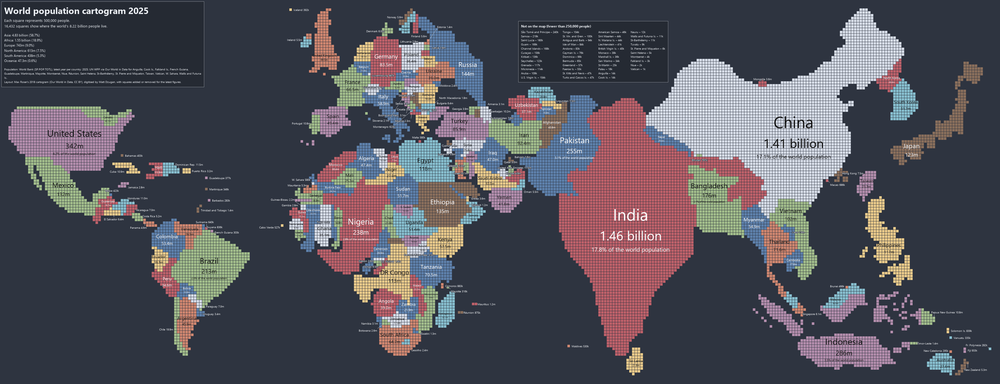

## How it works

**2018 layout (default).** Each country gets `round(population / 500,000)` squares and the
difference from 2018 is applied square by square:

- a country with a coast grows into the sea next to it, filling the hollows of its own outline
  first and avoiding cells that would close a strait (the Mediterranean, the Red Sea);
- a landlocked country takes a square from a neighbour along their shared border, choosing the
  square that keeps both shapes compact; that neighbour does the same with the next one, until a
  country that can grow into the sea;
- countries take turns, one square each per round, so growth is spread out;
- countries that shrank give up their most exposed coastal squares the same way.

**Computed layout (`--layout auto`).** A diffusion cartogram (Gastner–Newman) of the Natural Earth
map, with people spread inside each country along its cities, sampled on a square grid and then
balanced square by square. It works with any number of people per square, but the continents are
more distorted than in the hand-made 2018 layout.

**Outlines (`--style outlines`).** The same diffusion cartogram, but instead of sampling squares
every vertex of the Natural Earth borders is moved with the deformation. The diffusion runs on a
coarse grid and trims coasts and islands a little, so a final pass of the Dougenik–Chrisman–Niemeyer
algorithm adjusts the outlines until each country's area matches its population (median error
under 0.1%).

**Map (`--style map`).** The Natural Earth borders are projected directly, without any
deformation. Edges are densified to 1° first so straight borders curve properly in the curved
projections, and with another central meridian the polygons are cut where they cross the
opposite meridian. The globe's outline, a 30° graticule and the countries are drawn as vectors
(antialiased in PNG).

**Colours.** Each country gets the palette colour that looks most different (CIEDE2000 colour
difference) from its neighbours' colours, so neighbours never share a colour or a near-identical shade.

## Limitations

- Shapes and positions are approximate: this is a cartogram, not a map (except `--style map`).
- On `--style map` very small countries (Singapore, Malta, Pacific islands) are barely visible.
  Labels have no outline or halo: text only goes where it contrasts with every colour under it
  (black or white inside a country, the theme's text colour outside). Names that do not fit
  inside a country go beside it with a leader line; on the world map about
  35 small countries in the most crowded places (Balkans, Caribbean, African Great Lakes) stay
  unnamed so that labels never overlap (the log lists them) — `--region` or SVG output shows
  them all.
  Antarctica is left out.
- In the 2018 layout, the areas that grew most (West Africa, southern India) visibly bulge, and
  the further a year is from 2018 the more the shapes drift: by 2050 Africa is much rounder,
  and going back to 2000 leaves some countries ragged.
- With outlines, large empty countries (Canada, Russia, Australia, Norway) shrink to thin strips,
  and some neighbours of very populous countries come out long and narrow (West Africa).
- UN projections are projections: the medium variant, not a forecast of what will happen.
- Small countries in crowded areas (Europe, the Caribbean) have small labels; zoom in.
- The World Bank and the UN do not always agree on borders and on what a country includes; the
  figures used are written by `--csv`.

## License

The code is under the [MIT license](LICENSE). The generated maps derive from Max Roser's
cartogram and the data above, all CC BY 4.0: when you share them, credit **Our World in Data /
Max Roser**, **Matt Dzugan** and the data sources (the maps already carry this credit).
