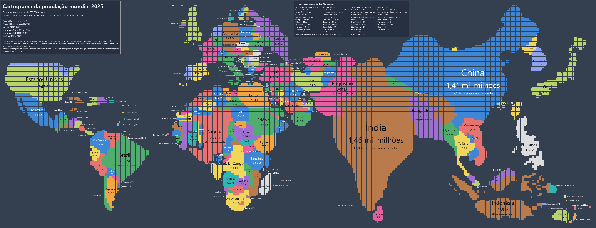
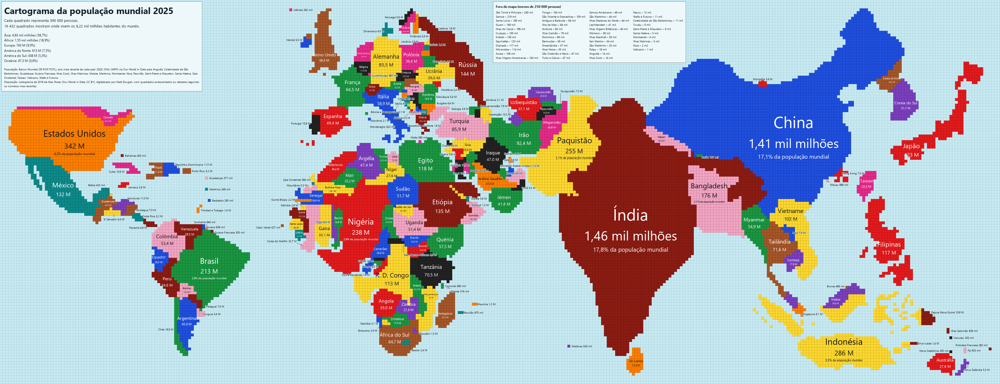
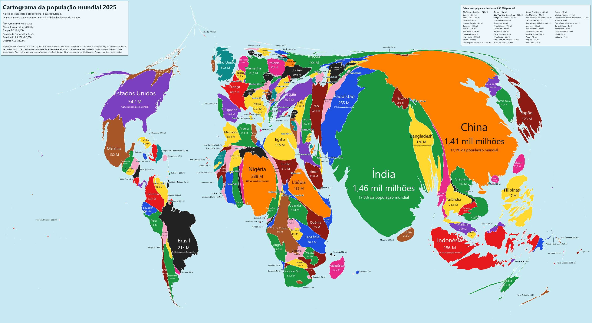

# Cartograma da população mundial, atualizado

*[English version](README.md)*

Cada quadrado são **500 000 pessoas**. Os países mantêm aproximadamente a forma e o lugar no
mapa-mundo: a Índia e a China ocupam meia Ásia, a Nigéria domina África, e o Canadá, a Rússia e a
Austrália quase desaparecem. 16 432 quadrados mostram onde vivem os 8,2 mil milhões de habitantes
do mundo.





Este projeto atualiza o **cartograma de 2018 de Max Roser** para a Our World in Data com os números
de população mais recentes (2025 para todos os países listados pelo Banco Mundial). Parte da
disposição de 2018, quadrado a quadrado, e só acrescenta ou retira os quadrados que cada país
ganhou ou perdeu. A disposição dos continentes fica como no original.

## Créditos e fontes

Este mapa não existiria sem:

- **Max Roser – Our World in Data (2018)**: [*The map we need if we want to think about how global
  living conditions are changing*](https://ourworldindata.org/world-population-cartogram), o
  cartograma em que esta disposição se baseia. CC BY 4.0.
- **Matt Dzugan – [World-Population-Cartogram](https://github.com/mattdzugan/World-Population-Cartogram)**:
  o cartograma de 2018 digitalizado à mão em dados (uma linha por quadrado). As perguntas frequentes
  desse repositório perguntam como fazer o mapa para outro ano; este projeto é uma resposta.
- **TeaDranks – World Population Cartogram 2015**, publicado no r/MapPorn do Reddit em janeiro de 2015
  ([artigo da NPR](https://www.npr.org/sections/goatsandsoda/2015/01/28/381971608/india-grows-russia-shrinks-mapping-countries-by-population)),
  a inspiração do tema claro.
- **População**: [Banco Mundial, SP.POP.TOTL](https://data.worldbank.org/indicator/SP.POP.TOTL)
  (CC BY 4.0), ano mais recente de cada país; para os territórios que não lista (Taiwan, Sara
  Ocidental, departamentos ultramarinos franceses...), [ONU, World Population Prospects, via Our
  World in Data](https://ourworldindata.org/grapher/population) (CC BY 4.0).
- **Mapa**: [Natural Earth](https://www.naturalearthdata.com/) (domínio público), para os nomes dos
  países e para a disposição calculada.
- **Método da disposição calculada**: M. T. Gastner e M. E. J. Newman, *Diffusion-based method for
  producing density-equalizing maps*, PNAS 101 (2004).
- **Estilo de contornos**: inspirado no [Worldmapper](https://worldmapper.org/maps/population-year-2022/)
  (Benjamin Hennig, Danny Dorling e colegas); as áreas são acertadas com J. A. Dougenik,
  N. R. Chrisman e D. R. Niemeyer, *An algorithm to construct continuous area cartograms*,
  The Professional Geographer 37 (1985).
- **Paleta para daltónicos**: Okabe & Ito e Paul Tol.
- **Estilo de mapa**: projeções Equal Earth (Šavrič, Patterson & Jenny, 2018), Robinson (1963),
  Winkel Tripel (1921), Mollweide (1805), Mercator, Miller (1942), Gall–Peters (Gall 1855,
  Peters 1973) e equirretangular. Quebras naturais: G. F. Jenks (1967), calculadas de forma exata
  com o método de W. D. Fisher (1958). Escalas de cor: Viridis, Magma e Cividis
  (matplotlib), Turbo (Google, usada em `rainbow`) e ColorBrewer (Cynthia Brewer).

## Utilização

Precisa de Python 3.9+ e de:

```bash
pip install numpy scipy pillow
```

```bash
python population_cartogram.py --theme both --lang pt -o mapa.png     # mapa_light.png + mapa_dark.png
python population_cartogram.py --theme dark --palette pastel
python population_cartogram.py --style outlines --theme dark          # contornos, ao estilo Worldmapper
python population_cartogram.py --style map --projection robinson       # mapa normal, pintado pela população
python population_cartogram.py --year 2050 --theme dark                # projeção da ONU
python population_cartogram.py --region europe --theme dark            # um continente, quadrados maiores
python population_cartogram.py --color-by gdp                          # mapa temático
python population_cartogram.py -o mapa.svg                             # saída vetorial
python population_cartogram.py --csv numeros.csv                       # também exporta os números usados
python population_cartogram.py --list-palettes
```

A primeira execução descarrega os dados (alguns MB) para `~/.cache/population_cartogram`. Os
números de população são renovados ao fim de 30 dias, por isso correr de novo para o ano dá o mapa
do ano seguinte.

### Contornos em vez de quadrados

`--style outlines` desenha um cartograma contínuo, como os do Worldmapper: as fronteiras reais
dos países, esticadas e encolhidas para que a área de cada país seja proporcional à sua
população. Os países continuam encostados aos vizinhos.




Todas as outras opções funcionam da mesma forma: `--year`, `--region`, `--color-by`, `--theme`,
`--palette`, `--lang` e a saída SVG.


A primeira execução de cada ano demora alguns minutos; o resultado fica em cache.

### Um mapa normal em vez de um cartograma

Os cartogramas de anos distantes ficam muito distorcidos: em 2050, e mais ainda em 2100, a África e
o Sul da Ásia incham e os continentes perdem a forma. `--style map` desenha o mapa geográfico
habitual, com os países pintados pela população numa escala que vai do país mais pequeno ao maior:

```bash
python population_cartogram.py --style map --lang pt                            # Equal Earth, 7 classes
python population_cartogram.py --style map --projection robinson --year 2100 --ramp rainbow --classes 9
python population_cartogram.py --style map --region europe --color-by life --ramp viridis
```


- **Projeções** (`--projection`): `equal-earth` (padrão; equivalente, por isso não exagera os países
  grandes), `robinson`, `winkel-tripel` (a dos mapas-mundo da National Geographic), `mollweide`
  (equivalente), `mercator` e `web-mercator` (mapas online; aumentam muito a Gronelândia, o Canadá
  e a Rússia), `miller` (um Mercator atenuado, para os polos caberem), `gall-peters` (equivalente,
  esticada na vertical nos trópicos) e `equirectangular` (plate carrée: longitude e latitude numa
  grelha simples). `--central-meridian 150` centra o mapa no Pacífico.
- **Classes** (`--classes N`, 2 a 12, padrão 7): a escala vai do menor ao maior valor dos países
  mostrados. `--breaks quantile` (padrão) ordena os países e dá a cada classe o mesmo número deles —
  com 233 países e 9 classes, 26 em cada — para nenhuma classe ficar vazia; cada limite é o número
  mais redondo entre o último país de uma classe e o primeiro da seguinte. `jenks` (quebras
  naturais) põe os limites nos maiores saltos entre valores, juntando países parecidos (numa escala
  logarítmica para valores positivos). `log` e `linear` fazem passos iguais; com valores tão
  desiguais como a população, a maioria dos países cai em poucas classes e algumas podem ficar
  vazias (o registo diz quantas).
- **Cores** (`--ramp`): `palette` (a escala da própria paleta, padrão), gradientes `blues`,
  `greens`, `reds`, `ylorrd`, `ylgnbu`, as perceptualmente uniformes `viridis`, `magma` e
  `cividis` (legíveis por daltónicos) e as escalas arco-íris `rainbow` (Turbo) e `spectral`.
  Acrescenta `_r` para inverter, p. ex. `viridis_r`.
- `--region`, `--year`, `--color-by`, `--theme`, `--lang` e o SVG funcionam como nos cartogramas.


`--classes`, `--breaks` e `--ramp` também funcionam nos cartogramas com `--color-by`.

### Anos passados e futuros

`--year` desenha qualquer ano entre 1950 e 2100. Até aos números mais recentes do Banco Mundial
usa as estimativas do Banco Mundial; depois disso, a **projeção da ONU (World Population Prospects
2024, variante média)**. Em 2050 o mundo precisa de 19 322 quadrados, e um quarto deles são africanos:


### Regiões

`--region europe` (ou `africa`, `asia`, `north-america`, `south-america`, `americas`, `oceania`)
recorta o mapa à volta de um continente, com quadrados e legendas maiores. Os países vizinhos
continuam visíveis, esbatidos.


### Mapas temáticos

`--color-by` pinta os países segundo um valor, em vez de apenas os distinguir: cada quadrado conta
as mesmas pessoas *e* mostra como é o seu país.

| Valor | Pinta por |
|---|---|
| `continent` | continente |
| `growth` / `growth:2000` | variação da população desde um ano-base (por omissão: 10 anos antes, ou hoje numa projeção) |
| `gdp`, `life`, `fertility`, `urban`, `density` | PIB per capita, esperança de vida, fecundidade, população urbana, densidade (Banco Mundial) |
| `wb:CÓDIGO` | qualquer indicador do Banco Mundial, p. ex. `wb:SE.ADT.LITR.ZS` (alfabetização) |
| `csv:FICHEIRO` | valores teus, `iso3,valor` (a segunda coluna do cabeçalho dá-lhes o nome) |

Os valores são divididos em classes com aproximadamente o mesmo número de países; a legenda e cada
etiqueta mostram-nos, e as fronteiras separam países com a mesma cor.


### SVG

Com `-o mapa.svg` o mapa é escrito em gráficos vetoriais: fica nítido em qualquer ampliação e pode
ser editado. Cada país é um grupo com o código ISO como `id` e o nome e a população como dica, para
o ficheiro poder ser reestilizado ou reutilizado numa página web. Ver
[world_2025_classic_dark.svg](examples/world_2025_classic_dark.svg).

### Opções

| Opção | O que faz |
|---|---|
| `--theme light\|dark\|both` | Tema claro (estilo 2015), escuro (estilo 2018) ou os dois |
| `--palette NOME` | Paleta de cores de `palettes.json` (padrão: `classic`) |
| `--palettes FICHEIRO` | Usar outro ficheiro de paletas |
| `--list-palettes` | Lista as paletas, procura cores parecidas e termina |
| `--style squares\|outlines\|map` | `squares` (padrão): um quadrado por 500 000 pessoas. `outlines`: contornos dos países com área proporcional à população. `map`: mapa geográfico normal pintado pela população |
| `--layout 2018\|auto` | Só quadrados. `2018` (padrão): disposição de 2018 atualizada. `auto`: calcula um cartograma novo a partir do mapa geográfico |
| `--projection NOME` | Só `--style map`: `equal-earth` (padrão), `mercator`, `web-mercator`, `winkel-tripel`, `robinson`, `mollweide`, `miller`, `gall-peters`, `equirectangular` |
| `--central-meridian GRAUS` | Só `--style map`: longitude ao centro (padrão 0, ou o meio da `--region`) |
| `--classes N` | Número de classes de cor, 2–12 (padrão 7 em `--style map`, 6 nos outros) |
| `--breaks quantile\|jenks\|log\|linear` | Como se cortam as classes: o mesmo número de países por classe (`quantile`, padrão), quebras naturais (`jenks`) ou passos iguais (`log`, `linear`) |
| `--ramp NOME` | Escala de cor: `palette`, `viridis`, `magma`, `cividis`, `blues`, `greens`, `reds`, `ylorrd`, `ylgnbu`, `rainbow`, `spectral`; `_r` inverte-a |
| `--year AAAA` | População desse ano (1950–2100); depois dos números mais recentes, a projeção da ONU |
| `--region NOME` | Só um continente: `africa`, `asia`, `europe`, `north-america`, `south-america`, `americas`, `oceania` |
| `--color-by O_QUÊ` | Mapa temático: `population`, `continent`, `growth[:ANO]`, `gdp`, `life`, `fertility`, `urban`, `density`, `wb:CÓDIGO`, `csv:FICHEIRO` |
| `--lang en\|pt\|es` | Idioma dos textos e dos nomes dos países (padrão: o do sistema) |
| `-o FICHEIRO` | Ficheiro de saída, `.png`, `.svg` ou `.pdf` |
| `--per-cell N` | Pessoas por quadrado (padrão 500 000; outros valores só com `--layout auto`) |
| `--cell-px N` | Tamanho de cada quadrado em píxeis (padrão 10; automático com `--region`) |
| `--source auto\|worldbank\|owid` | Fonte da população (padrão: Banco Mundial, com a Our World in Data para o resto) |
| `--data FICHEIRO.csv` | Números teus, `iso3,população[,ano]`, que se sobrepõem aos descarregados |
| `--csv FICHEIRO` | Exporta os números usados (país, população, ano, fonte, quadrados) |
| `--cache PASTA` / `--offline` | Onde guardar os downloads / usar só o que já lá está |
| `--detail`, `--passes`, `--ocean`, `--rural`, `--blur-km` | Afinação da disposição calculada (`--layout auto` e `--style outlines`) |

### Paletas

O `palettes.json` guarda as paletas. Cada paleta tem uma versão `light` e uma `dark`, cada uma com
`background` (o mar), `box_text` e `box_fill` (caixas de título e de legenda) e 4 a 16 cores em
`countries`. As listas opcionais `sequential` e `diverging` definem as escalas de cor dos mapas
temáticos. Acrescenta as tuas e verifica-as com `--list-palettes`.

Incluídas: `classic`, `pastel`, `colorblind`, `neon` e `earth`.


## Como funciona

**Disposição de 2018 (padrão).** Cada país recebe `round(população / 500 000)` quadrados e a
diferença para 2018 é aplicada quadrado a quadrado:

- um país com costa cresce para o mar ao lado, preenchendo primeiro as reentrâncias do seu contorno
  e evitando fechar estreitos (Mediterrâneo, Mar Vermelho);
- um país sem costa recebe um quadrado de um vizinho na fronteira comum, escolhido para manter as duas
  formas compactas; esse vizinho faz o mesmo com o seguinte, até um país que possa crescer para o mar;
- os países crescem à vez, um quadrado por ronda, para o crescimento ficar repartido;
- os países que diminuíram cedem os quadrados de costa mais expostos, da mesma forma.

**Disposição calculada (`--layout auto`).** Um cartograma por difusão (Gastner–Newman) do mapa do
Natural Earth, com a população espalhada dentro de cada país segundo as suas cidades, amostrado numa
grelha de quadrados e depois acertado quadrado a quadrado. Funciona com qualquer número de pessoas
por quadrado, mas os continentes ficam mais distorcidos do que na disposição de 2018, feita à mão.

**Contornos (`--style outlines`).** O mesmo cartograma por difusão, mas em vez de amostrar
quadrados cada vértice das fronteiras do Natural Earth é deslocado com a deformação. A difusão
corre numa grelha grosseira e apara um pouco as costas e as ilhas, por isso uma passagem final do
algoritmo de Dougenik–Chrisman–Niemeyer acerta os contornos até a área de cada país corresponder
à sua população (erro mediano abaixo de 0,1%).

**Mapa (`--style map`).** As fronteiras do Natural Earth são projetadas diretamente, sem deformação.
Os segmentos são primeiro densificados a 1° para as fronteiras retas curvarem bem nas projeções
curvas, e com outro meridiano central os polígonos são cortados onde atravessam o meridiano oposto.
O contorno do globo, uma quadrícula de 30° e os países são desenhados como vetores (com
antialiasing no PNG).

**Cores.** Cada país recebe a cor da paleta que mais se distingue (diferença de cor CIEDE2000) das
cores dos vizinhos, para que vizinhos nunca tenham a mesma cor nem tons quase iguais.

## Limitações

- Formas e posições são aproximadas: é um cartograma, não um mapa (exceto com `--style map`).
- Em `--style map` os países muito pequenos (Singapura, Malta, ilhas do Pacífico) mal se veem. Os
  nomes que não cabem dentro do país ficam ao lado, com uma linha de chamada; no mapa-mundo, uns 35
  países pequenos dos sítios mais apertados (Balcãs, Caraíbas, Grandes Lagos africanos) ficam sem
  nome para as etiquetas não se sobreporem (o registo diz quais) — `--region` mostra-os todos. A
  Antártida fica de fora.
- Na disposição de 2018, as zonas que mais cresceram (África Ocidental, sul da Índia) ficam
  visivelmente mais salientes, e quanto mais longe de 2018 mais as formas se afastam do original:
  em 2050 a África fica muito mais redonda, e recuar até 2000 deixa alguns países recortados.
- Com contornos, os países grandes e vazios (Canadá, Rússia, Austrália, Noruega) ficam reduzidos
  a tiras finas, e alguns vizinhos de países muito populosos ficam compridos e estreitos (África
  Ocidental).
- As projeções da ONU são projeções: a variante média, não uma previsão do que vai acontecer.
- Os países pequenos em zonas apertadas (Europa, Caraíbas) têm legendas pequenas; é preciso ampliar.
- O Banco Mundial e a ONU nem sempre concordam nas fronteiras e no que cada país inclui; os números
  usados ficam registados com `--csv`.

## Licença

O código está sob a [licença MIT](LICENSE). Os mapas gerados derivam do cartograma de Max Roser e
dos dados acima, todos CC BY 4.0: ao partilhá-los, credita **Our World in Data / Max Roser**,
**Matt Dzugan** e as fontes dos dados (os mapas já trazem este crédito).
